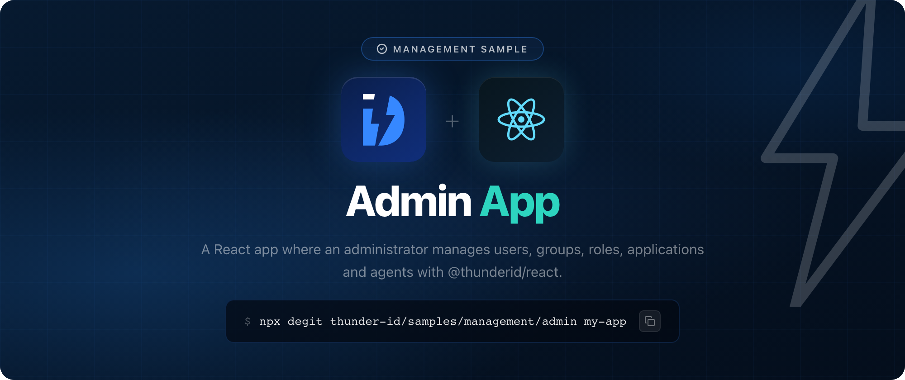

# ThunderID Admin Sample

A React (Vite and TypeScript) app where an administrator signs in and manages the resources of a ThunderID server from one place, built with the [ThunderID React SDK](https://www.npmjs.com/package/@thunderid/react) (`@thunderid/react`). It has these sections:

- **Home**: a short page that explains what the app is for, with a card for each section.
- **Users**: lists and searches users, creates one, and opens a user to edit their attributes, see their groups, delete them, suspend, unsuspend and unlock them, or edit the sharing policies that decide which other organization units can see them.
- **Groups**: lists groups, creates one, and opens a group to add and remove its members or delete it.
- **Roles**: lists roles, creates one, and opens a role to add and remove the permissions it grants, assign it to users, groups, applications and agents, take it away, delete it, or edit its sharing policies.
- **Applications**: lists the applications in the current project, creates one there (a confidential client's secret is shown once), and opens one to edit it, regenerate its secret, suspend or unsuspend it, delete it, or edit its sharing policies.
- **Agents**: lists the agents in the current project, creates one there, or creates one through the ThunderID agent onboarding flow, and opens one to see its groups and roles, suspend, unsuspend and unlock it, or delete it.
- **Flows**: lists the flows on your server, and opens one to edit its sharing policies.
- **Projects**: lists projects, creates one, and opens a project to rename it, edit its description or delete it. The project picker in the sidebar sets the current project.
- **Organization units**: lists the root units and the child units of any unit, creates a root or child unit, and opens a unit to edit it, delete it, or see its child units, users, groups and roles.
- **My account**: the signed-in administrator's own profile, which they can edit, and a form to change their password.

The organization unit menu in the top bar lists the organization units the signed-in administrator can access, and switches the session to the one they choose. It shows only when there is more than one.

The current project scopes the application and agent lists, and new applications and agents are created in it. A project is not an organization unit: the SDK sends the project as `projectId`, and the server places the resource in the project's root organization unit. With no project chosen, the lists show everything you can see and new resources go into your own organization unit.

The suspend, unsuspend and unlock actions run through the administration flows your server configures, and show only when a flow is configured for them.

Creating an agent through the onboarding flow (**Agents → Onboard with a flow**) starts the flow that lives on your ThunderID server. The SDK draws each step the flow sends back: who owns the agent, the agent's details, and the new credentials. The client secret is shown once, hidden until you choose to show it.

| Route                                                                       | Page                    | SDK component                                                                                             |
| --------------------------------------------------------------------------- | ----------------------- | --------------------------------------------------------------------------------------------------------- |
| All                                                                         | App setup               | `ThunderIDProvider`                                                                                       |
| All                                                                         | Top bar                 | `SignInButton`, `SignedIn`, `SignedOut`, `Loading`, `UserDropdown`                                        |
| All                                                                         | Organization unit menu  | `OrganizationUnitSwitcher`, drawn as a select through its custom render                                   |
| All signed-in pages                                                         | Sidebar and route guard | `ProjectSwitcher`, and `ProtectedRoute` (from `@thunderid/react-router`)                                  |
| `/`                                                                         | Home                    | `User`                                                                                                    |
| `/users`, `/users/new`, `/users/:id`                                        | Users                   | `UserList`, `UserCreate`, `UserDetails`, `SharingPolicies`                                                |
| `/groups`, `/groups/new`, `/groups/:id`                                     | Groups                  | `GroupList`, `GroupCreate`, `GroupDetails` (with `GroupMembers`)                                          |
| `/roles`, `/roles/new`, `/roles/:id`                                        | Roles                   | `RoleList`, `RoleCreate`, `RoleDetails` (with `RolePermissions` and `RoleAssignments`), `SharingPolicies` |
| `/applications`, `/applications/new`, `/applications/:id`                   | Applications            | `ApplicationList`, `ApplicationCreate`, `ApplicationDetails`, `SharingPolicies`                           |
| `/agents`, `/agents/new`, `/agents/:id`                                     | Agents                  | `AgentList`, `AgentCreate`, `AgentDetails`                                                                |
| `/agents/onboard`                                                           | Agent onboarding flow   | `BaseInviteUser`, with `BaseUserSelect`, `TextField`, `Select`, `CopyableText` and `Button` for its steps |
| `/flows`, `/flows/:id`                                                      | Flows                   | The `getFlows` and `getFlow` functions, and `SharingPolicies`                                             |
| `/projects`, `/projects/new`, `/projects/:id`                               | Projects                | `ProjectList`, `ProjectCreate`, `ProjectDetails`                                                          |
| `/organization-units`, `/organization-units/new`, `/organization-units/:id` | Organization units      | `OrganizationUnitList`, `OrganizationUnitCreate`, `OrganizationUnitDetails`                               |
| `/account`                                                                  | My account              | `UserProfile`, `ChangeCredential`                                                                         |

`/organization-units?parent=<id>` lists the child units of a unit, and `/organization-units/new?parent=<id>` creates a child unit.

The app also uses the SDK hooks `useThunderID`, `useManagementRequestConfig`, `useFetchUsers`, `useFetchAuthFlows`, `useFetchUserTypes`, `useTheme`, and `useTranslation`. The organization unit dropdown and the step buttons of the onboarding flow are drawn by the app itself, through the SDK's custom renderers in `src/renderers.tsx`.

## Prerequisites

- Node.js 20 or later
- A running ThunderID server (`https://localhost:8090` by default) and an administrator account
- The agent onboarding flow on that server. A standard install already has one, named `default-agent-onboarding-flow`.

The sample needs `@thunderid/react` 1.15.0 or later, the first release with the components for projects, organization units, sharing policies and organization unit switching. `npm install` fetches it.

## Get the sample

Download the latest zip from the [releases](https://github.com/thunder-id/samples/releases?q=sample%2Fmanagement%2Fadmin&expanded=true), or copy the source:

```bash
npx degit thunder-id/samples/management/admin my-app
cd my-app
```

## Configure

1. In the ThunderID Console, create a **React** application with `http://localhost:5173` as its redirect URL, and copy its client ID. Then add `http://localhost:5173` to the allowed origins (**Settings → CORS**), or the browser blocks the sign-in requests.

2. Create your `.env`:

   ```bash
   cp .env.example .env
   ```

   | Variable                            | Description                                                                                        |
   | ----------------------------------- | -------------------------------------------------------------------------------------------------- |
   | `VITE_THUNDERID_BASE_URL`           | Base URL of your ThunderID server.                                                                 |
   | `VITE_THUNDERID_CLIENT_ID`          | Client ID of the application.                                                                      |
   | `VITE_AGENT_ONBOARDING_FLOW_HANDLE` | Handle of the flow that creates agents. Defaults to `default-agent-onboarding-flow`.               |
   | `VITE_THUNDERID_RESOURCE`           | Optional. The resource that guards admin information. A standard install already uses the default. |

## Run

```bash
npm install
npm run dev
```

Open [http://localhost:5173](http://localhost:5173) and sign in as an administrator.

Only administrators can use the management sections. Anyone else can sign in, but the server turns down the requests and the page shows an error.

## Learn more

- [React quickstart guide](https://thunderid.dev/docs/getting-started/connect-your-application/react)
- [React SDK reference](https://thunderid.dev/docs/sdks-and-tools/react/overview)

## License

Apache License 2.0. See [LICENSE](https://github.com/thunder-id/samples/blob/main/LICENSE).
