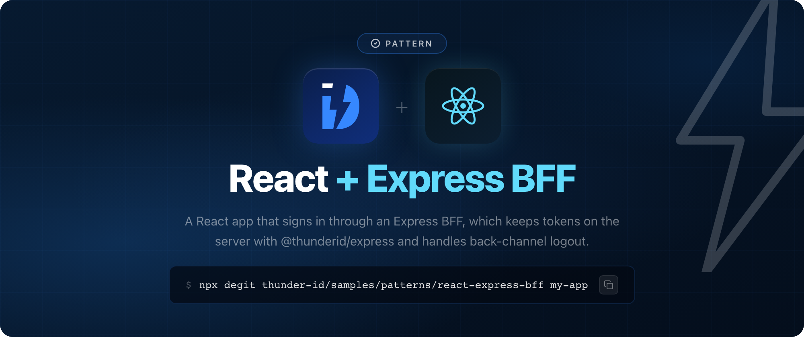
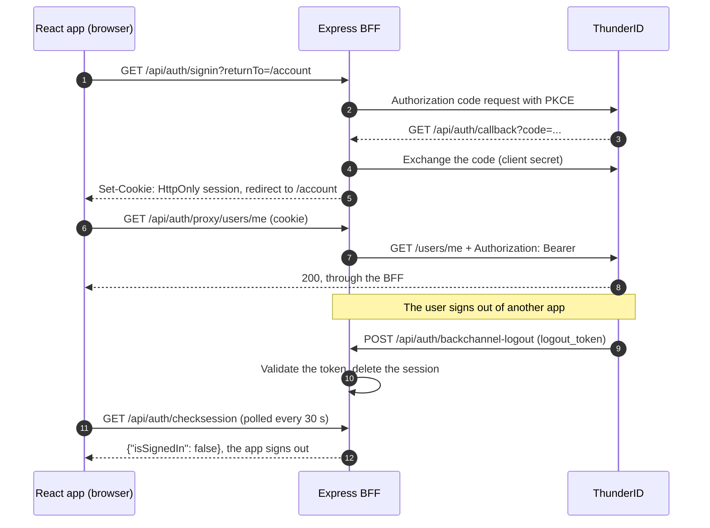

# ThunderID React + Express BFF Sample

A React app that signs in through a Backend for Frontend (BFF) built with Express and the [ThunderID Express SDK](https://www.npmjs.com/package/@thunderid/express) (`@thunderid/express`). Sign-in runs on the BFF, which keeps the access, refresh, and ID tokens. The browser only holds an `HttpOnly` session cookie that scripts cannot read, so a script injected into the page has no token to steal. The BFF also ends its sessions when ThunderID sends an OpenID Connect back-channel logout.

| Folder | What it is |
|---|---|
| [`client`](client) | The React and Vite app, using the [ThunderID React SDK](https://www.npmjs.com/package/@thunderid/react) (`@thunderid/react`) in BFF mode |
| [`server`](server) | The Express BFF |

## How it works



The app and the BFF share one origin. In development the Vite dev server forwards `/api/auth` to the BFF, so the session cookie is first party and no CORS setup is needed.

The BFF is stateful. The cookie holds only a session ID, and the tokens stay in the BFF's session store, which is what lets a back-channel logout end a session.

## Prerequisites

- Node.js 22 or later
- A running ThunderID server (`https://localhost:8090` by default)

## Get the sample

Download the latest zip from the [releases](https://github.com/thunder-id/samples/releases?q=sample%2Fpatterns%2Freact-express-bff&expanded=true), or copy the source:

```bash
npx degit thunder-id/samples/patterns/react-express-bff my-app
cd my-app
```

## Configure

1. In the ThunderID Console, create a confidential application with a client secret. Open it, go to **Advanced Settings → OAuth2 Configuration**, and set:

   | Field | Value |
   |---|---|
   | Authorized redirect URI | `http://localhost:5173/api/auth/callback` |
   | Post-Logout Redirect URI | `http://localhost:5173` |
   | Back-Channel Logout URI | `http://localhost:3001/api/auth/backchannel-logout` |

   The redirect URIs are on the React app's origin. ThunderID calls the back-channel logout URI directly, server to server, so it points at the BFF itself.

2. Create the BFF's `.env`:

   ```bash
   cp server/.env.example server/.env
   ```

   | Variable | Description |
   |---|---|
   | `THUNDERID_BASE_URL` | Base URL of your ThunderID server. |
   | `THUNDERID_CLIENT_ID` | Client ID of the application. |
   | `THUNDERID_CLIENT_SECRET` | Client secret of the application. Server-only. |
   | `APP_URL` | The origin the browser opens the app on. Defaults to `http://localhost:5173`. |
   | `API_BASE_URL` | The API the BFF's proxy forwards to. Defaults to `THUNDERID_BASE_URL`. |
   | `PORT` | The port the BFF listens on. Defaults to `3001`. |
   | `NODE_TLS_REJECT_UNAUTHORIZED` | Set to `0` in the example to accept a local server's self-signed certificate. Local development only. |

   The React app needs no configuration. To run the BFF somewhere other than `http://localhost:3001`, set `BFF_URL` when you start the dev server.

## Run

```bash
npm install
npm run dev
```

This starts the BFF on port 3001 and the React app on port 5173. Open [http://localhost:5173](http://localhost:5173) and sign in. The app never receives a refresh token or an ID token. The Token debug page shows the access token from `POST /api/auth/token`.

## Use the BFF from a React app

The React SDK switches to BFF mode when `endpoints.backend` is set. Every endpoint defaults to `/api/auth/*` on the app's origin, so the provider needs no client ID or base URL:

```jsx
<ThunderIDProvider endpoints={{ backend: {} }} session={{ checkInterval: 30 }}>
  <App />
</ThunderIDProvider>
```

`session.checkInterval` is how often, in seconds, the SDK asks the BFF whether the session still exists. It also asks whenever the tab gets focus.

Hooks and components work as they do without a BFF. Every SDK request carries `X-Requested-With: XMLHttpRequest`. API calls made through the SDK's HTTP client go to `/api/auth/proxy/*`, and the BFF adds the access token. In BFF mode, `getDecodedIdToken()` returns the `user` from `/api/auth/session`, and `getIdToken()` is rejected because the ID token stays on the server.

## Endpoints

All under `/api/auth`. Every endpoint the browser SDK calls requires the `X-Requested-With: XMLHttpRequest` header, which a cross-site page cannot send without a CORS preflight, so the cookie cannot be used for cross-site request forgery.

| Endpoint | What it does |
|---|---|
| `GET /signin` | Starts sign-in and comes back to the app path in `returnTo` |
| `GET /callback` | The OAuth redirect URI. Exchanges the code and sets the session cookie |
| `GET /session` | `{isSignedIn, user, expiresAt, scope}`. Refreshes an expired access token first |
| `GET /checksession` | `{isSignedIn}` only. Never refreshes, so the app can poll it |
| `POST /refresh` | Refreshes the access token with the refresh token held here |
| `POST /signout` | Ends the BFF session and returns `{redirectUrl}`, the ThunderID end-session URL |
| `POST /token` | The access token, without the refresh token, for APIs the app calls directly |
| `ALL /proxy/*` | Forwards to `API_BASE_URL` with `Authorization: Bearer`. `401 login_required` when the session is gone |
| `POST /backchannel-logout` | Receives ThunderID's logout token and deletes the session it names |

## Back-channel logout

When the user's ThunderID session ends anywhere else, ThunderID posts a signed logout token to `/api/auth/backchannel-logout`. The SDK's `handleBackchannelLogout()` checks the signature, issuer, audience, and replay, then deletes the BFF session that joined the ended ThunderID session. The React app finds out the next time it asks `/api/auth/checksession`, or on its next API call, and signs the user out.

To try it:

1. ThunderID refuses localhost and private network addresses as back-channel logout URIs by default. For local testing only, turn that off in the server's `deployment.yaml` and restart it:

   ```yaml
   oauth:
     logout:
       backchannel:
         reject_private_addresses: false
   ```

2. Make sure the authentication flow has the **Check SSO Session** and **Save / Load Session** nodes. Without them ThunderID records no session and sends no logout.
3. Sign in to the React app, then sign in to a second application in the same browser, so both share one ThunderID session.
4. Sign out of the second application. Within 30 seconds, or as soon as you switch back to the React app's tab, it shows you as signed out. The BFF logs the session it ended.

## Going to production

- Serve the React build and the BFF from the same origin, for example behind one reverse proxy, and set `APP_URL` to it. With `https`, the session cookie is marked `Secure`.
- Remove `NODE_TLS_REJECT_UNAUTHORIZED=0`.
- The SDK keeps sessions in memory, so restarting the BFF signs everyone out. With more than one BFF instance, give the SDK a shared store, since ThunderID's back-channel request reaches only one of them.

## Learn more

- [React SDK reference](https://thunderid.dev/docs/sdks-and-tools/react/overview)
- [Express SDK reference](https://thunderid.dev/docs/sdks-and-tools/express/overview)
- [Back-Channel Logout in ThunderID](https://thunderid.dev/docs/guides/protocols/oauth-oidc/backchannel-logout)

## License

Apache License 2.0. See [LICENSE](https://github.com/thunder-id/samples/blob/main/LICENSE).
