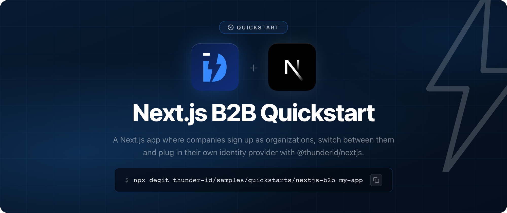

# ThunderID Next.js B2B Quickstart

A Next.js App Router app for a B2B SaaS product, built with the [ThunderID Next.js SDK](https://www.npmjs.com/package/@thunderid/nextjs) (`@thunderid/nextjs`). Each company that signs up becomes its own organization in ThunderID. People sign in to one company at a time, their tokens name that company and the roles they hold there, and a company admin plugs in the company's own identity provider. Tokens stay on the server.

| What it shows | How |
|---|---|
| Company sign-up | The sign-in page offers **Register your company**. It creates the company as an organization unit, creates the first admin and signs them in. |
| Account inside the company, or shared | Sign-up asks where the account lives. **My account belongs to this company** creates it inside the company. **I work with several companies** creates it in the platform organization and shares it into the company, so it can join more companies later. |
| Organization and roles in the token | The page reads the access token on the server and shows its `ouId`, `ouHandle`, `ouName`, `roles` and `scope`. |
| Switching companies | `OrganizationUnitSwitcher` lists the companies the account belongs to. See [Switching companies](#switching-companies). |
| Enterprise SSO per company | A company admin adds an OpenID Connect identity provider through the SDK's management fetcher, and selects it with `FlowVariablesForm`. Employees then choose **Sign in with enterprise SSO** and enter the company's handle. |

## Prerequisites

- Node.js 20.9 or later
- A running ThunderID server (`https://localhost:8090` by default), built from the `main` branch. The sample uses features newer than ThunderID 2.0.0-m1, such as the `org` permission.

## Get the sample

Download the latest zip from the [releases](https://github.com/thunder-id/samples/releases?q=sample%2Fquickstarts%2Fnextjs-b2b&expanded=true), or copy the source:

```bash
npx degit thunder-id/samples/quickstarts/nextjs-b2b my-app
cd my-app
```

## Configure

### Import the ThunderID resources

`thunderid-config/` holds two files that create everything the app needs, with fixed IDs so the app's configuration works unchanged. Import them in the ThunderID Console, in this order:

1. Sign in to the Console. With the quickstart image it is the Control Plane console, `https://localhost:8095/console`.
2. On the **welcome screen** (shown on first sign-in, or from the user profile menu), choose **Open** and upload `thunderid-config/organization-unit.yaml`. It needs no environment file.
3. Open the welcome screen again, upload `thunderid-config/thunderid-config.yaml`, then `thunderid-config/thunderid.env` for its variables.

The Console tests each import before it runs it, and that test only finds an organization unit that already exists. The second file places every resource in the organization unit the first one creates, so import the first one on its own.

| Resource | Name | What it does |
|---|---|---|
| Organization unit | Next.js B2B Quickstart (`nextjs-b2b-quickstart`) | The platform organization, a root organization unit in the Default project. Every company that signs up becomes its child. |
| User type | Next.js B2B User (`nextjs-b2b-user`) | The account schema, with self-registration on. Usable in every company. |
| Server config | `defaultResourceServer` | Makes the System resource server the default. The app names no resource when it signs in or switches, so its tokens are issued for the System resource server and an admin's token carries `org`. |
| Role | Admin | Grants the `org` permission, which manages the organization the token names. Shared with every company. |
| Role | Member | Grants no permission. Shared with every company. |
| Flow | Next.js B2B Quickstart Company Sign-up | Creates the company and its first admin, with the account inside the company or shared into it |
| Flow | Next.js B2B Quickstart Sign-in | Password, enterprise SSO, or company sign-up. Keeps a single sign-on session, so a switch does not ask for the password again. Shared with every company, which may set `enterpriseIdp`. |
| Application | Next.js B2B Quickstart | Confidential client with PKCE, redirecting to `http://localhost:3000`. Shared with every company. |

The imports create a root organization unit and replace the `defaultResourceServer` setting, and only the Control Plane writes those, so import there. Imported straight into a Data Plane, both are refused.

`thunderid.env` sets two variables:

| Variable | Description |
|---|---|
| `NEXTJS_B2B_CLIENT_ID` | Client ID of the application. Defaults to `NEXTJS_B2B_QUICKSTART`. |
| `NEXTJS_B2B_CLIENT_SECRET` | Client secret of the application. Change it before you import, and set the same value in `.env`. |

### Configure the app

```bash
cp .env.example .env
```

Set `THUNDERID_SECRET` to a long random string, for example from `openssl rand -base64 32`. The other defaults match the import.

| Variable | Description |
|---|---|
| `NEXT_PUBLIC_THUNDERID_BASE_URL` | Base URL of your ThunderID server |
| `NEXT_PUBLIC_THUNDERID_CLIENT_ID`, `THUNDERID_CLIENT_SECRET` | Credentials of the application |
| `NEXT_PUBLIC_THUNDERID_AFTER_SIGN_IN_URL` | Where ThunderID returns the browser after sign-in |
| `NEXT_PUBLIC_THUNDERID_AFTER_SIGN_OUT_URL` | Where ThunderID returns the browser after sign-out |
| `NEXT_PUBLIC_THUNDERID_SCOPES` | `ou` and `roles` put the company and the roles held there into the tokens. `org` asks for the permission a company admin needs. |
| `NEXT_PUBLIC_THUNDERID_SIGN_IN_FLOW_ID` | ID of the sign-in flow, whose `enterpriseIdp` variable a company admin sets |
| `THUNDERID_SECRET` | Encrypts the session cookie |
| `NODE_TLS_REJECT_UNAUTHORIZED` | Set to `0` in the example to accept a local server's self-signed certificate. Local development only. |

## Run

```bash
npm install
npm run dev
```

Open [http://localhost:3000](http://localhost:3000).

## Try it

### A company with its own accounts

1. Choose **Sign in**, then **Register your company** on the ThunderID sign-in page.
2. Choose **My account belongs to this company**. Enter a username, an email and a password, then `Northstar Labs` as the company name and `northstar` as its handle.
3. You land in the app, signed in to Northstar Labs. The access token names it in `ouId`, `ouHandle` and `ouName`, lists `Admin` in `roles`, and carries `org` in `scope`.

### Plug in the company's identity provider

1. Register an OpenID Connect application in your identity provider, with the callback URL the app shows, `https://localhost:8090/gate/callback`.
2. In the app's **Enterprise SSO** section, choose **Create a connection** and enter the application's client ID, client secret and endpoints.
3. Select the new connection and choose **Save changes**.
4. Sign out, choose **Sign in**, then **Sign in with enterprise SSO**, and enter `northstar`. ThunderID sends you to the company's identity provider. A first-time employee joins the company as a `Member`.

### One account across several companies

1. Sign out, choose **Sign in**, then **Register your company**, and choose **I work with several companies**. Register `Initech` with the handle `initech`. The account lives in the platform organization and is shared into Initech as its `Admin`.
2. As a platform administrator, in the ThunderID Console:
   1. Under **Organization units**, open `Next.js B2B Quickstart` and add two child organization units, `Globex` and `Umbrella`.
   2. Under **Users**, open the account and select the **Affiliations** tab. Add `Globex` with access to that unit only and the mandated role `Admin`, then `Umbrella` with the mandated role `Member`. Save.
3. Sign out and sign in with the account's password. ThunderID asks which company to sign in to. Pick **Umbrella**: the page shows `Member`, the token's `scope` has no `org`, and the Enterprise SSO section is gone. Sign in again and pick **Globex**: you are its `Admin`, and you can plug in Globex's own identity provider.

### Switching companies

The organization menu in the header lists every company the account belongs to. Picking one sends the browser to that company's sign-in, where the single sign-on session signs the user in without the password. `@thunderid/nextjs` 1.18.1 redeems the returning code only when no session exists, so the page stays on the previous company. Until the SDK finishes the switch itself, sign out and sign in again to move between companies.

## How it works

- **One application, many companies.** The application, both roles and the sign-in flow belong to the platform organization and are shared with every child, so a company works the moment it signs up.
- **Sign-up.** The sign-up flow creates the company beneath the platform organization (`OUExecutor`). For an account inside the company, it creates the user there and assigns `Admin`. For a shared account, it creates the user in the platform organization, shares the user into the company (`SharingExecutor`) and assigns `Admin` there (`RoleExecutor`). The sign-in flow calls the sign-up flow, so the new admin lands in the app signed in.
- **Which company a sign-in lands in.** Enterprise SSO decides it from the handle. A password sign-in picks the one company the user belongs to, or asks.
- **What a company admin can do.** The `Admin` role grants `org` on the System resource server. On a Data Plane, `org` reaches only the organization unit the token names. The SDK sends the management calls from the server with the admin's session, so the admin's changes apply to their own company and the token never reaches the browser.
- **Enterprise SSO.** The sign-in flow declares `enterpriseIdp` as a connection variable, and its sharing policy lets every company set its own value. The OpenID Connect step reads the connection from `{{var(enterpriseIdp)}}`.

## Before you go to production

A company admin's token carries `org`, which manages everything in their company. Grant it only to people you trust with the whole company, or route management calls through your own server routes that check each call and use a client that holds the permission, as the [Wayfinder Enterprise sample](https://github.com/thunder-id/samples/tree/main/b2b/wayfinder-enterprise) does.

## Learn more

- [Secure B2B SaaS applications](https://thunderid.dev/docs/next/use-cases/b2b/overview)
- [Next.js SDK reference](https://thunderid.dev/docs/next/sdks-and-tools/nextjs/overview)

## License

Apache License 2.0. See [LICENSE](https://github.com/thunder-id/samples/blob/main/LICENSE).
