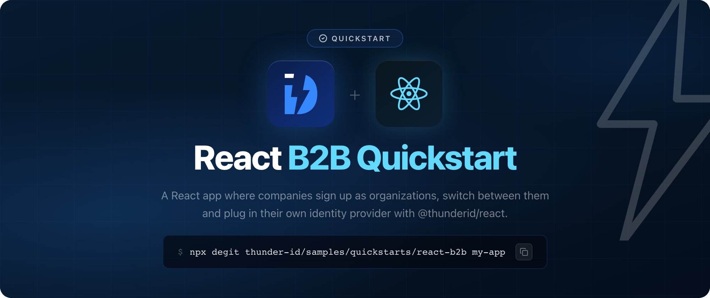

# ThunderID React B2B Quickstart

A React and Vite app for a B2B SaaS product, built with the [ThunderID React SDK](https://www.npmjs.com/package/@thunderid/react) (`@thunderid/react`).

| What it shows | How |
|---|---|
| Company sign-up | The sign-in page offers **Register your company**. It creates the company as an organization unit, creates the first admin and signs them in. |
| Account inside the company, or shared | Sign-up asks where the account lives. **My account belongs to this company** creates it inside the company. **I work with several companies** creates it in the Default organization unit and shares it into the company, so it can join more companies later. |
| Organization and roles in the token | The app shows the access token's `ouId`, `ouHandle`, `ouName`, `roles` and `scope`. |
| Switching companies | `OrganizationUnitSwitcher` lists the companies the account belongs to and switches the session to the one picked, without leaving the page. The new tokens name that company and the roles held there. |
| Enterprise SSO per company | A company admin adds an OpenID Connect identity provider with `createConnection`, and selects it with `FlowVariablesForm`. Employees then choose **Sign in with enterprise SSO** and enter the company's handle. |

## Prerequisites

- Node.js 20 or later
- A running ThunderID server (`https://localhost:8090` by default), built from the `main` branch. The sample uses features newer than ThunderID 2.0.0-m1, such as the `org` permission.

## Get the sample

Download the latest zip from the [releases](https://github.com/thunder-id/samples/releases?q=sample%2Fquickstarts%2Freact-b2b&expanded=true), or copy the source:

```bash
npx degit thunder-id/samples/quickstarts/react-b2b my-app
cd my-app
```

## Configure

### Import the ThunderID resources

`thunderid-config/thunderid-config.yaml` creates everything the app needs in the Default organization unit, with fixed IDs so the app's configuration works unchanged. Every company that signs up becomes a child of the Default organization unit. Import it in the ThunderID Console:

1. Sign in to the Console. With the quickstart image it is the Control Plane console, `https://localhost:8095/console`.
2. Choose **Import / Export**, then **Import**. Upload `thunderid-config/thunderid-config.yaml` as the configuration file and `thunderid-config/thunderid.env` as the environment variables file.
3. Choose **Continue**, then **Import configuration**.

The import replaces the `defaultResourceServer` setting, which only the Control Plane writes, so import there. Imported straight into a Data Plane, it is refused.

| Resource | Name | What it does |
|---|---|---|
| User type | React B2B User (`react-b2b-user`) | The account schema, with self-registration on. Usable in every company. |
| Server config | `defaultResourceServer` | Makes the System resource server the default, for authorization requests that name no resource |
| Role | React B2B Admin | Grants the `org` permission, which manages the organization the token names. The role is shared with every company. |
| Role | React B2B Member | Grants no permission. The role is shared with every company. |
| Flow | React B2B Quickstart Company Sign-up | Creates the company and its first admin, with the account inside the company or shared into it |
| Flow | React B2B Quickstart Sign-in | Password, enterprise SSO, or company sign-up. Keeps a single sign-on session, so a switch does not ask for the password again. Shared with every company, which may set `enterpriseIdp`. |
| Application | React B2B Quickstart | Public client with PKCE and the token exchange grant, redirecting to `http://localhost:5173`. The application is shared with every company. |

`thunderid.env` sets one variable:

| Variable | Description |
|---|---|
| `REACT_B2B_CLIENT_ID` | Client ID of the application. Defaults to `REACT_B2B_QUICKSTART`. |

Then add `http://localhost:5173` to the CORS allowed origins, so the browser lets the application call ThunderID. Clear the project selection, choose **Configurations** in the sidebar, then **CORS**. Choose **Add origin**, enter `http://localhost:5173`, and choose **Save changes**.

### Configure the app

```bash
cp .env.example .env
```

The defaults match the import.

| Variable | Description |
|---|---|
| `VITE_THUNDERID_BASE_URL` | Base URL of your ThunderID server |
| `VITE_THUNDERID_CLIENT_ID` | Client ID of the application |
| `VITE_THUNDERID_RESOURCE` | Identifier of the System resource server. Sign-in and switching name it, so an admin's token carries `org`. |
| `VITE_THUNDERID_SIGN_IN_FLOW_ID` | ID of the sign-in flow, whose `enterpriseIdp` variable a company admin sets |

## Run

```bash
npm install
npm run dev
```

Open [http://localhost:5173](http://localhost:5173).

## Try it

### A company with its own accounts

1. Choose **Sign in**, then **Register your company** on the ThunderID sign-in page.
2. Choose **My account belongs to this company**. Enter a username, an email and a password, then `Northstar Labs` as the company name and `northstar` as its handle.
3. You land in the app, signed in to Northstar Labs. The access token names it in `ouId`, `ouHandle` and `ouName`, lists `React B2B Admin` in `roles`, and carries `org` in `scope`.

### Plug in the company's identity provider

1. Register an OpenID Connect application in your identity provider, with the callback URL the app shows, `https://localhost:8090/gate/callback`.
2. In the app's **Enterprise SSO** section, choose **Create a connection** and enter the application's client ID, client secret and endpoints.
3. Select the new connection and choose **Save changes**.
4. Sign out, choose **Sign in**, then **Sign in with enterprise SSO**, and enter `northstar`. ThunderID sends you to the company's identity provider. A first-time employee joins the company as a `React B2B Member`.

The setting applies to Northstar Labs only. Another company sees its own value, or none.

### One account across several companies

Until the sample has a flow that invites an existing account into another company, create an account that belongs to every company in the Console:

1. Register a second company, such as `Initech` with the handle `initech`, so there are two to switch between.
2. In the Control Plane console, `https://localhost:8095/console`, open **Users** and choose **Add user**. Select the user type **React B2B User**, which places the account in the Default organization unit. Enter a username, such as `react-consultant`, an email and a password, then choose **Create user**.
3. Open the account and select the **Affiliations** tab. Choose **Default and chosen organization units**, keep **All child organization units**, and choose **Save**. The account now belongs to every company beneath the Default organization unit, including the ones that sign up later.
4. Sign out of the app, choose **Sign in**, and sign in with the account. ThunderID asks which company to sign in to. Pick **northstar**.
5. Open the organization menu in the header and pick **Initech**. The page switches to Initech without leaving the app or asking for the password.

The account holds no role in these companies, so the token's `roles` is empty and the Enterprise SSO section does not show.

## How it works

- **One application, many companies.** The application, both roles and the sign-in flow belong to the Default organization unit and are shared with every child, so a company works the moment it signs up.
- **Sign-up.** The sign-up flow creates the company beneath the Default organization unit (`OUExecutor`). For an account inside the company, it creates the user there and assigns `React B2B Admin`. For a shared account, it creates the user in the Default organization unit, shares the user into the company (`SharingExecutor`) and assigns `React B2B Admin` there (`RoleExecutor`). The sign-in flow calls the sign-up flow, so the new admin lands in the app signed in.
- **Which company a sign-in lands in.** Enterprise SSO decides it from the handle. A password sign-in picks the one company the user belongs to, or asks.
- **Switching.** The app asks for the `device_sso` scope, so the sign-in also returns a device secret, which carries the flow's single sign-on session. A switch exchanges it at `/ou/{ouId}/oauth2/token` for tokens bounded to the company the app names, with no redirect and no password. When the exchange needs the user, the SDK sends the browser to `/ou/{ouId}/oauth2/authorize` instead.
- **What a company admin can do.** The `React B2B Admin` role grants `org` on the System resource server. On a Data Plane, `org` reaches only the organization unit the token names, so the admin's `createConnection` and `FlowVariablesForm` calls change their own company.
- **Enterprise SSO.** The sign-in flow declares `enterpriseIdp` as a connection variable, and its sharing policy lets every company set its own value. The OpenID Connect step reads the connection from `{{var(enterpriseIdp)}}`.

## Before you go to production

The app runs entirely in the browser, so the SDK keeps the tokens and the device secret in browser storage, where any script on the page can read them. The device secret matters most: until the single sign-on session ends, whoever holds it can get tokens for every company the account belongs to, without the user. The app also can't support single logout: if users sign in to this app and another app through single sign-on, signing out of the other app leaves them signed in here until their tokens stop working. If either matters, pick one of these setups:

- **Build with Next.js (recommended).** The Next.js SDK signs users in on the server, keeps the tokens in an `HttpOnly` cookie that scripts cannot read, and receives back-channel logout. See the [Next.js B2B quickstart](https://github.com/thunder-id/samples/tree/main/quickstarts/nextjs-b2b).
- **Add a Backend for Frontend (BFF).** Keep this React app and add a small server that signs users in and holds the tokens, so the browser gets only an `HttpOnly` session cookie. See the [React and Express BFF sample](https://github.com/thunder-id/samples/tree/main/patterns/react-express-bff) and [how to set up a BFF](https://thunderid.dev/docs/next/sdks-and-tools/react/guides/backend-for-frontend).

A company admin's token also carries `org`, which manages everything in their company. Grant it only to people you trust with the whole company, or route management calls through a backend that holds the permission and checks each call, as the [Wayfinder Enterprise sample](https://github.com/thunder-id/samples/tree/main/b2b/wayfinder-enterprise) does.

## Learn more

- [Secure B2B SaaS applications](https://thunderid.dev/docs/next/use-cases/b2b/overview)
- [React SDK reference](https://thunderid.dev/docs/next/sdks-and-tools/react/overview)

## License

Apache License 2.0. See [LICENSE](https://github.com/thunder-id/samples/blob/main/LICENSE).
